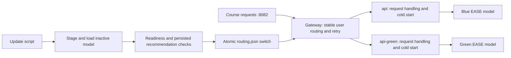

# M3 model switching and updates (issue #40)

The [November 13 production rehearsal](verification/m3-rehearsal-2026-11-13.md)
records the initial migration, a newer model activated in production, and a brief
split between distinct versions. Submission-window updates and course-log
availability evidence remain separate completion requirements.

## What changed

Question answered: how can we replace a loaded model while keeping the public
recommendation endpoint available?



M1/M2 had one API owning public port 8082; replacing it stopped serving during
startup. [Compose](compose.yaml) now gives that port to a small
[gateway](src/api/gateway.py). The `api` (blue) and `api-green` model servers use
separate slot files in the shared model volume. Their diagnostic ports 8083 and
8084 are bound only to VM localhost. The gateway reads the complete old or new
routing file for each request. In-flight requests retain their selected server.
Both versions can serve concurrently using a stable hash of user ID and a saved
salt. Response headers expose the assigned slot, actual slot, model hash, routing
generation and request ID; the existing request log records the loaded model hash.

The gateway retries the other server on connection failure, timeout, invalid output
or a server error. It reserves a total 550 ms for backend work; a retry requests a
shorter cold-start wait so fallback recommendations can still finish. This leaves
some of the course's 600 ms limit for network overhead, but production Kafka logs
remain the authority on successful responses. There is no replica of the gateway
or VM. Two loaded API processes use more memory in exchange for uninterrupted model
startup. The profile workers share an OS lock to avoid concurrent paid preparation
of the same cache miss; the lock releases if a process exits.

## Initial migration of the existing VM

Do this before the final grading window. Preserve `/home/production/.env`, the
private Kafka configuration and all named volumes. Record the exact source commit
in `APP_REVISION`. Do not use `down`, `--volumes`, or `RETRAIN_MODEL=1`.

After transferring the reviewed source, build `model-update`, `api`, `api-green`
and `gateway` while the legacy API continues serving. Run this once to copy its
existing artifact/manifest into both slots without downloading or retraining:

```bash
cd /home/production
sudo docker compose --project-name recommendationmodel build model-update api api-green gateway
sudo docker compose --project-name recommendationmodel run --rm --no-deps -T model-update src/deployment.py initialize --primary green
sudo docker compose --project-name recommendationmodel up -d --no-deps --no-build api-green
sudo docker compose --project-name recommendationmodel run --rm --no-deps -T model-update src/deployment.py wait green
```

`--primary green` applies only when the routing file is first created. Check the
printed configuration; if slots/routing already exist, investigate the previous
migration before continuing. Verify the new server and start the gateway on a
temporary localhost port while the old API still owns 8082:

```bash
sudo docker compose --project-name recommendationmodel run --rm --no-deps -T model-update \
  src/model_update.py verify --manifest /app/models/slots/green/artifact-manifest.json --base-url http://api-green:8082
sudo env GATEWAY_PORT=127.0.0.1:18082 docker compose --project-name recommendationmodel up -d --no-deps --no-build gateway
curl --retry 20 --retry-delay 1 --retry-connrefused -fsS http://127.0.0.1:18082/health/routing
curl -fsS -D - http://127.0.0.1:18082/recommend/1
sudo docker stats --no-stream
```

Stop here unless routing names green, the response is valid with `x-model-slot:
green`, and memory remains sufficient for two model servers. The one-time port
handoff below can have a brief gap; it is not a qualifying model update. Keep the
legacy container until the gateway is verified. These commands belong to the
same VM shell, so the saved container ID remains available:

```bash
legacy_api=$(sudo docker compose --project-name recommendationmodel ps -q api)
test -n "$legacy_api"
sudo docker stop --time 15 "$legacy_api"
sudo docker compose --project-name recommendationmodel up -d --no-deps --no-build --force-recreate gateway
curl --retry 20 --retry-delay 1 --retry-connrefused -fsS http://127.0.0.1:8082/health/ready
curl -fsS -D - http://127.0.0.1:8082/recommend/1
```

If either public check fails, stop and restore the retained API before proceeding:

```bash
sudo docker compose --project-name recommendationmodel stop gateway
sudo docker start "$legacy_api"
curl --retry 120 --retry-delay 5 --retry-connrefused -fsS http://127.0.0.1:8082/health/ready
```

After successful checks, replace the old blue container on localhost 8083 and
confirm both servers. Green continues serving throughout blue's startup:

```bash
sudo docker compose --project-name recommendationmodel up -d --no-deps --no-build --force-recreate api
sudo docker compose --project-name recommendationmodel run --rm --no-deps -T model-update src/deployment.py wait blue
sudo bash scripts/switch_model.sh green
curl -fsS http://127.0.0.1:8082/health/storage
```

Do not run regular updates before migration is complete. The saved M2 root artifact
is retained for recovery; it is no longer selected for regular serving or training.
Initially both slots contain that same model. Run a rehearsal update after migration
to produce two distinct versions, briefly exercise a 50% split, and retain the switch
record's successful public probes for both versions. End the split before the next
update. Rehearsals outside the final 72-hour window do not count toward the rubric.

## Regular updates and rollback

With the migrated deployment running and `.env` recording the deployed commit:

```bash
cd /home/production
sudo bash scripts/update_model.sh
```

The [script](scripts/update_model.sh) holds one host lock shared with traffic
switches. It rejects an active traffic split, checks the active model identity,
builds only the update and replacement API images, exports recent data through the
existing M2 quality gates, and trains the existing EASE model. It validates the
candidate against the active artifact and requires a distinct hash and a later
training-data endpoint than the preceding update (when recorded). Only the inactive
slot's artifact and container are replaced. The active API and gateway keep running.

[Deployment checks](src/deployment.py) allow ten minutes for startup, require the
loaded model hash to match the candidate manifest, and verify an actual response
and its persisted request log. Both servers must be ready before activation. A
single atomic routing change promotes the new model; a failed public verification
restores the previous routing file. Failed preparation/training/readiness leaves
the active routing unchanged. Review any failure before retrying. The original
candidate, exact training export, manifest and `deployment.json` remain under the
printed `/app/models/updates/<run>/` directory. Re-running provisioning does not
overwrite slots or their provenance.

To inspect state, choose a traffic split, end a split, or roll back to the other
still-running version:

```bash
sudo docker compose --project-name recommendationmodel run --rm --no-deps -T model-update src/deployment.py status
# Example: blue is control, with 50% of users assigned to green.
sudo bash scripts/switch_model.sh blue --secondary-percent 50
# End that split; send all traffic to blue.
sudo bash scripts/switch_model.sh blue
# Alternatively, send all traffic to the ready green version.
sudo bash scripts/switch_model.sh green
curl -fsS http://127.0.0.1:8082/health/routing
curl -fsS http://127.0.0.1:8082/health/storage
curl -fsS -D - http://127.0.0.1:8082/recommend/1
```

Each switch saves a record in `/app/models/switches/` unless an explicit record path
is supplied. Rollback is a routing switch, not a rebuild. The next update replaces
the inactive slot, so preserve the archived runs if older artifacts are needed.
Do not deploy source that changes both server interfaces through this model-only
procedure; this ticket assumes compatible backend HTTP interfaces.

## Required production evidence

Run **two distinct updates during the 72 hours before the actual submission**.
Rehearsal updates earlier than that do not count. Choose times inside that window
with enough separation for genuinely newer retained training observations. Confirm
both updates' successful public probes and distinct model hashes in their saved
records. The implementation alone does not satisfy this operational requirement.

After each update, wait at least six minutes, then save the five-minute before/after
course Kafka observations. Replace the run path and exact server field with the
values from the update output and course logs:

```bash
sudo bash scripts/save_update_evidence.sh /app/models/updates/<run>/deployment.json \
  --server '<exact server field>'
```

When the actual submission time is known, repeat with
`--submission 'YYYY-MM-DDTHH:MM:SS+00:00'` to record the 72-hour check. The
[exporter](src/update_evidence.py) reads indexed partition tails, includes non-200
and timed-out requests in the denominator, and saves `availability.json` plus
`availability-requests.jsonl.gz` beside the update record. Missing follow-up,
unattributable requests or insufficient tail coverage must not be presented as
100% availability. Inspect the report; increase `--max-events` or wait for ingestion
when needed. The report describes observed requests and partition coverage, not a
guarantee that the consumer captured every course event.

Copy the two deployment/availability records and request samples out of the model
volume for the M3 report. Include the update times, previous/new hashes, successful
public requests, and before/after Kafka success counts. Link this implementation
and explain the deployment change above. Add actual evidence only after executing
the updates; none is fabricated by the scripts.

## Local verification

Run `python -m pytest` with `requirements-dev.txt` installed. Tests exercise
concurrent requests during a switch, stable user assignment, bounded retries,
readiness rejection, automatic rollback, unchanged active artifacts after staging
failures, orchestration failures, cross-process profile locking and Kafka evidence
that includes failed requests. Existing CI runs these tests and builds the image
without production credentials. Check runtime resources and external serving on
the VM as well; the rehearsal above records the checks completed so far.
