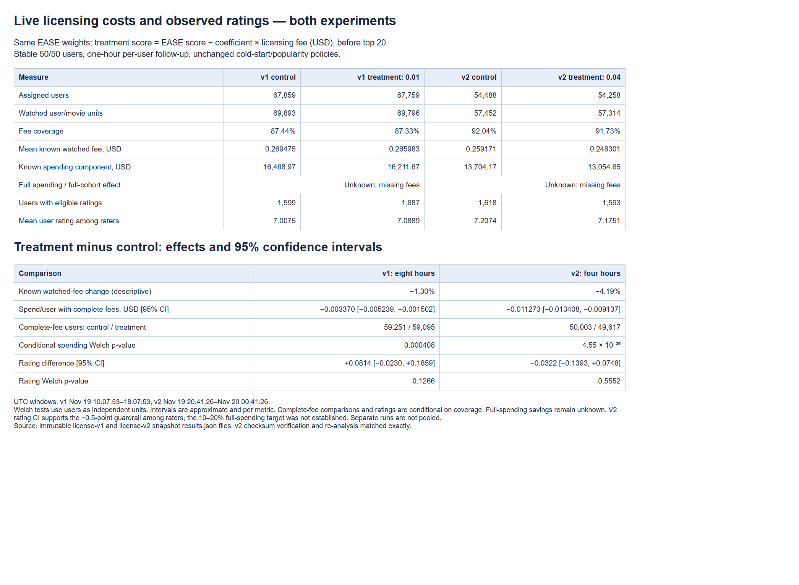

# Licensing-cost experiments

## Design and measurement

[EASE ranking](src/recommender.py) uses the **same frozen weights** in both arms.
Control is unchanged; treatment ranks eligible personalized candidates by
`EASE_score - penalty * licensing_fee_USD` before choosing top 20. Seen/unpopular
exclusions and tie breaks remain unchanged. LLM cold-start and popularity-only
policies are unchanged. Missing, negative or nonfinite fees are unknown, not free:
ranking uses the maximum validated snapshot fee for unknowns; accounting does not
assign them a price.

Blue serves control and green serves treatment. [The gateway](src/api/gateway.py)
hashes a saved salt and normalized user ID for stable 50/50 assignment, logs the
assigned and actual served arm, and retains fallback for availability. The
[launcher](src/license_experiment.py) freezes weights, fee sources/checksums,
penalty, serving IDs, duration and decision criteria. The gateway automatically
returns to control after enrollment plus follow-up.

A user's first request during enrollment starts one hour of follow-up; repeated
requests do not reset it. Failed requests and cross-arm fallback remain assigned
to the original arm. [Kafka capture](src/experiments/capture.py) saves original
watches/ratings before compaction and before committing offsets.

[Analysis](src/experiments/analysis.py) measures:

- **Spending/user:** sum one fee per distinct user/movie watched strictly after
  first assignment and before follow-up ends, including movies outside the slate.
  Include assigned users with no watches as zero. This is a viewing-unit proxy,
  not actual billing.
- **Watched-movie fee:** summed fees divided by watched user/movie units,
  reported descriptively.
- **Rating:** latest valid submitted 1-10 rating per watched movie, at/after its
  first qualifying watch and within follow-up; average within user, then equally
  across raters. Missing ratings are not zero.

Two-sided Welch tests give treatment-minus-control differences, approximate 95%
confidence intervals and p-values for **per-user** spending and ratings. Users
are the independent randomization units; Welch permits unequal variances.
Intervals are per metric, not simultaneous. Ratings describe observed raters.
Any missing watched fee makes full spending and its effect unknown; complete-fee
user comparisons are explicitly conditional. Duration stays fixed: no early
stopping on significance.

## Results



| Run | Fixed penalty | Enrollment + follow-up | UTC observation window |
| --- | ---: | --- | --- |
| [v1](verification/m3-license-v1-results.json) | 0.01 | 7h + 1h | Nov 19, 10:07:53-18:07:53 |
| [v2](verification/m3-license-v2-results.json) | 0.04 | 3h + 1h | Nov 19, 20:41:26-Nov 20, 00:41:26 |

| Measure | v1 control | v1 treatment | v2 control | v2 treatment |
| --- | ---: | ---: | ---: | ---: |
| Assigned users | 67,859 | 67,759 | 54,488 | 54,258 |
| Users with watches | 67,859 | 67,759 | 54,469 | 54,243 |
| Watched user/movie units | 69,893 | 69,796 | 57,452 | 57,314 |
| Fee-covered units | 61,115 | 60,950 | 52,877 | 52,576 |
| Fee coverage | 87.44% | 87.33% | 92.04% | 91.73% |
| Mean known watched fee, USD | 0.269475 | 0.265983 | 0.259171 | 0.248301 |
| Known spending component, USD | 16,468.97 | 16,211.67 | 13,704.17 | 13,054.65 |
| Known spending/assigned user, USD | 0.242694 | 0.239255 | 0.251508 | 0.240603 |
| Raters | 1,599 | 1,687 | 1,618 | 1,593 |
| Rated units | 1,604 | 1,689 | 1,623 | 1,605 |
| Raters/assigned users | 2.36% | 2.49% | 2.97% | 2.94% |
| Mean per-rater rating | 7.0075 | 7.0889 | 7.2074 | 7.1751 |

| Treatment minus control | v1 | v2 |
| --- | --- | --- |
| Known watched-fee change (descriptive) | -1.30% | -4.19% |
| Complete-fee-user spend difference, USD | -0.003370 | -0.011273 |
| Spending 95% CI | [-0.005239, -0.001502] | [-0.013408, -0.009137] |
| Spending p-value | 0.000408 | 4.55e-25 |
| Complete-fee users, control/treatment | 59,251 / 59,095 | 50,003 / 49,617 |
| Rating difference | +0.0814 | -0.0322 |
| Rating 95% CI | [-0.0230, +0.1859] | [-0.1393, +0.0748] |
| Rating p-value | 0.1266 | 0.5552 |

**Interpretation:** cheaper movies were watched among fee-covered units, with a
larger within-run reduction under 0.04. Known spending per assigned user fell
1.42% and 4.34%, respectively, but these exclude unknown fees. **Full spending
savings remain unknown in both runs**, and the v2 10% minimum / 20% desired
full-spending target was not established. The conditional spending intervals
exclude zero; neither rating interval does. V2's rating interval lies above its
pre-specified -0.5-point guardrail among raters. This does not prove equal
satisfaction for every user. Nearly all users watched in both arms, so the
observed known-fee reduction was not simply a large decline in watcher counts.
Runs used different periods and fee snapshots: do not pool them or interpret
their difference as a randomized comparison of coefficients.

V1 recorded 186,196 requests and 19 fallbacks; v2 recorded 150,779 requests,
9 failed responses and 14 fallbacks. Assignment-balance p-values were 0.7881 and
0.4874. Both gateway logs were healthy/drained at export and both partitions
bracketed full follow-up. Capture reported 10,503 and 7,420 invalid outcomes over
the broader capture periods, not necessarily enrolled-user missing outcomes.
V2 had historical pre-enrollment backend log failures (blue 3, green 1);
recovered writes were verified before launch without clearing those counters.
Its separate gateway experiment log had no failures. V2 checksums and independent
snapshot re-analysis matched exactly.

## Deploy and run

Use the reviewed local source on the VM. Preserve `.env`, Kafka configuration,
project name and volumes; never reset offsets or recreate gateway/Kafka for this
ranking change. Finish/export any registered experiment first and coordinate
with teammates to prevent model updates during rollout. Use a **new ID**, not v1/v2.

```bash
set -euo pipefail
cd /home/durbonas/RecommendationModel
export APP_REVISION="$(git rev-parse HEAD)"
git archive HEAD | sudo tar -x --no-same-owner -C /home/production
cd /home/production
export LICENSE_EXPERIMENT_ID=license-next
export LICENSING_TREATMENT_PENALTY=0.04

dc() {
  sudo env APP_REVISION="$APP_REVISION" LICENSE_EXPERIMENT_ID="$LICENSE_EXPERIMENT_ID" \
    LICENSING_TREATMENT_PENALTY="${LICENSING_TREATMENT_PENALTY:-0.04}" \
    docker compose --project-name recommendationmodel "$@"
}
license() { sudo env APP_REVISION="$APP_REVISION" bash scripts/license_experiment.sh "$@"; }
experiment() { sudo env APP_REVISION="$APP_REVISION" bash scripts/experiment.sh "$@"; }
wait_slot() { dc run --rm --no-deps -T model-update src/deployment.py wait "$1" --timeout 1800; }
switch() { sudo env APP_REVISION="$APP_REVISION" bash scripts/switch_model.sh "$1"; }

dc build model-update api api-green
license prepare --id "$LICENSE_EXPERIMENT_ID" --penalty 0.04 \
  --fees /app/models/license-policies/license-v2/fees.csv \
  --enrollment-hours 3 --follow-up-hours 1 --rating-decline-margin 0.5

# Green first runs unchanged control while blue is replaced.
license stage --id "$LICENSE_EXPERIMENT_ID" --slot green
LICENSING_TREATMENT_PENALTY=0 dc -f compose.yaml -f compose.license-experiment.yaml up -d --no-deps --no-build api-green
wait_slot green
switch green
license stage --id "$LICENSE_EXPERIMENT_ID" --slot blue
dc -f compose.yaml -f compose.license-experiment.yaml up -d --no-deps --no-build api
wait_slot blue
switch blue
# Load treatment into inactive green; blue continues serving control.
dc -f compose.yaml -f compose.license-experiment.yaml up -d --no-deps --no-build api-green
wait_slot green
```

Each wrapper holds the shared update/switch lock for its command; coordinate the
whole sequence with other operators. Stop on failure; do not rerun preparation
against an existing ID. Cache import can take more than ten minutes. Preparation
archives active weights/lineage, refreshes frequently observed missing movie fees
with at most 256 rate-limited requests, and reports rejected/deferred unknowns.
Inspect coverage rather than assuming every watch will be priced.

Before starting, check `/health/model` and `/health/storage` on localhost ports
8083/8084, plus `/health/experiment` and `/health/routing` on 8082. Require equal
weight/catalog hashes, distinct serving IDs, blue unpenalized, green at 0.04 with
the saved fee hash, persisted recommendation probes, healthy/drained logging and
current Kafka observations in both partitions. Investigate health failures rather
than clearing counters. Routing must remain blue/0% with no registered run.

```bash
license start --id "$LICENSE_EXPERIMENT_ID"
```

Start is three minutes ahead. The fixed 50/50 run lasts **four hours** and then
automatically returns to blue. For the original eight-hour design use
`--enrollment-hours 7 --follow-up-hours 1` during preparation instead.
Do not rebuild, retrain, change fees, switch traffic or send synthetic
recommendation probes during observation.

## Export, reproduce and finish

After the printed observation end plus one minute, wait for both Kafka partitions
to cover that time. Export refuses unhealthy gateway logging, a gateway restart,
changed served versions or incomplete partition coverage.

```bash
experiment export --id "$LICENSE_EXPERIMENT_ID"
sudo docker cp "$(dc ps -q api)":"/app/models/experiments/$LICENSE_EXPERIMENT_ID/snapshot/results.html" "/tmp/$LICENSE_EXPERIMENT_ID-results.html"
experiment analyze \
  --snapshot "/app/models/experiments/$LICENSE_EXPERIMENT_ID/snapshot"
experiment finish
```

The immutable snapshot preserves plan, frozen fees, original requests/outcomes,
checksums and HTML/JSON/Markdown results under `/app/models/experiments/<id>/snapshot`.
Keep user-level data private; publish aggregates and the screenshot. To recover
during observation use `src/experiment.py finish --abort-reason 'incident details'`;
an aborted run is not a completed result. Both runs reported above were exported
and finished without aborting; control remains active.
