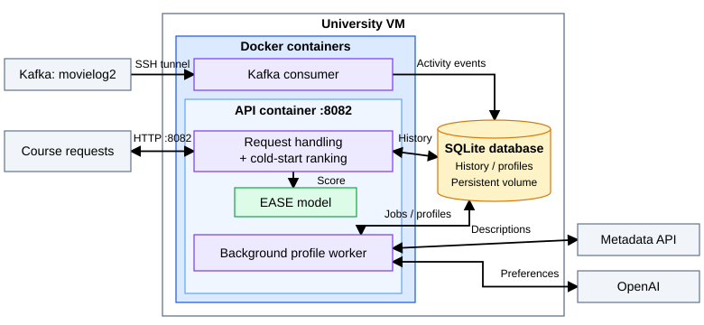

# Milestone 1 - Movie Recommendation Service

## Model comparison

Evaluation tool: https://github.com/Revenge-of-the-Fit/RecommendationModel/tree/add-model-comparison-harness/model_comparison
Tests each model through an adapter without editing its source and prints results against a popularity baseline.

### Milestone 0 Model Repositories

William: https://github.com/Helixan/RecommendationModel
Sara: https://github.com/MajorTomLanded/rec-zilla
Muhammad: https://github.com/MuhammadDF/S3D17645_M0
Daniel: https://github.com/d-urbonas/CMU-MLinProd

### Four Qualities

#### Prediction accuracy

Metric: We used NDCG@10 and HitRate@10. A held-out movie is relevant if rated at least 7. NDCG sums binary relevance divided by `log2(rank + 1)`, normalizes by the ideal top 10, and averages across users. HitRate is the fraction of users with at least one relevant top-10 movie.

Data: We used the course M0 events, users, and movies. Watch/rating events are grouped into user-movie pairs with watch counts and the latest rating, then split per user at random 60/20/20 (train, validation and test). The dataset includes 955 users with a relevant test movie.

Operationalization: To repeat the split, sort user-movie pairs and shuffle each user's pairs with one NumPy `default_rng(42)` generator. Take `max(1, floor(0.2 * pairs))` for each held-out set and train on the rest; histories with fewer than three pairs remain in training. We chose each model's hyperparameters by the best validation NDCG@10 on 200 sampled users with a relevant validation movie, then refit on train plus validation. After that we took each test user's top 10 once movies already watched or rated in train plus validation and IDs outside the catalog were removed. Daniel's model uses self-descriptions, so we scored it on the 665 test users with nonempty likes. Every model also got scored on the same fixed 50 of those users. Sample sorted eligible user IDs without replacement using seed 42. Empty recommendation lists score zero.

Accuracy measurement: https://github.com/Revenge-of-the-Fit/RecommendationModel/blob/add-model-comparison-harness/model_comparison/metrics.py

#### Training cost

Metric: We tested seconds to fit the model, and memory growth during the fit.

Data: We used the train+validation interactions, at the hyperparameters chosen above. Sara also uses MovieLens ratings.

Operationalization: We timed the model's fit call and took the median over three runs for local models. Memory growth is resident memory after the first fit minus what it was before. Reading files inside the fit counts as part of the time. Sara's MovieLens loading happens outside it, but building her combined ratings matrix is included. Daniel skips rating training; here we time one catalog-embedding run.

#### Inference cost

Metric: latency of one top-10 recommendation request: median and 95th percentile.

Data: 200 sampled test users for local models; 665 described users for Daniel.

Operationalization: We timed each call on the first fitted model, excluding initial model loading and HTTP. Daniel's timings include the LLM and embedding calls; cached results retain the original request time.

#### Model size

Metric: We measured serialized model size in MiB.

Data: We used the fitted model.

Operationalization: We measured `len(pickle.dumps(model, protocol=pickle.HIGHEST_PROTOCOL))`, divided by `2**20`. For Sara we serialized the model's state, including MovieLens ratings. For Daniel we measured his catalog-embeddings file.

Training, inference, and size measurements: https://github.com/Revenge-of-the-Fit/RecommendationModel/blob/add-model-comparison-harness/model_comparison/costs.py

| Measure | William | Sara | Muhammad | Daniel | popularity (baseline) |
|---|---|---|---|---|---|
| NDCG@10, 955 test users | 0.195 | 0.002 | 0.040 | 0.011* | 0.107 |
| NDCG@10, shared 50-user sample | 0.165 | 0.000 | 0.052 | 0.000 | 0.108 |
| HitRate@10, 955 test users | 0.555 | 0.012 | 0.168 | 0.051* | 0.390 |
| Fit time | 0.40 s | 0.15 s | 0.23 s | 15.1 s† | 0.01 s |
| Fit memory growth | 352 MiB | 262 MiB | 37 MiB | n/a | 1 MiB |
| Latency p50 / p95 | 0.3 / 0.4 ms | 1103 / 1120 ms | 1.6 / 1.7 ms | 1742 / 2467 ms | 0.0 / 0.1 ms |
| Model size | 31.9 MiB | 86.0 MiB | 1.4 MiB | 15.1 MiB | 43.5 KiB |

\* Scored on 665 of the 955 test users with nonempty likes. † One-time catalog embedding, one run; memory growth not reported.

Hyperparameters chosen on validation: William regularization 100, min rating 6; Sara neighborhood size 5; Muhammad 10 neighbors; Daniel none.

### Decision

We decided to use William's model in production. It is the only model that beats the popularity baseline, and 55.5% of users get at least one relevant movie in their top 10. Other models were strong in places: Sara's model fits fastest and Muhammad's is the smallest and needs the least measured memory to fit. William's won because it is the only model that both beats the baseline and has measured inference latency below 600 ms. This leaves room for HTTP handling within the service deadline.

Limits of this comparison: We tested using users with rating history only, so performance for users without history is not evaluated; and top-10 ranking suits EASE's training objective better than the rating-prediction models.

## Prediction service

Our recommendation service uses EASE to rank movies based on the user's history. We use FastAPI to serve requests at `http://CMU-ONLINE-MLIP-VM02.ANDREW.CMU.EDU:8082/recommend/<userid>`. The service returns up to 20 movie IDs in a single comma separated line, ordered from highest to lowest recommendation. The model is loaded when the service starts so that we do not have to load it again for every request.

Request handling: https://github.com/Revenge-of-the-Fit/RecommendationModel/blob/main/src/api/routes.py

To start, EASE learns movie-to-movie relationships from binary user profiles. A rating of at least 6 out of 10 or a watch without a rating counts as a positive interaction. Provisioning defaults to regularization 100 and minimum rating 6. When making recommendations, we simply add the learned weight rows for the user's positive movies to produce a score for each candidate movie. Movies the user has already seen and movies without positive training interactions are excluded. We sort the remaining movies by score, using popularity and then movie ID to break ties.

Training: https://github.com/Revenge-of-the-Fit/RecommendationModel/blob/main/src/train.py
Ranking: https://github.com/Revenge-of-the-Fit/RecommendationModel/blob/main/src/recommender.py

In addition, the service reads watch and rating events from the course's `movielog2` Kafka topic. We combine this activity with the user's original training history when making recommendations. An explicit rating takes precedence over a watch, and the latest rating replaces an older rating. This allows us to use EASE for users who were not in the original dataset as long as they have positive interactions with supported movies. The learned EASE weights remain the same; our changes allow the running service to use new history and prepare cold-start profiles automatically.

Serving: https://github.com/Revenge-of-the-Fit/RecommendationModel/blob/main/src/services/recommendation.py

For users without supported positive history, our background worker retrieves their likes and dislikes from the metadata API. Registration events automatically queue this work, and recommendation requests also queue users whose registration we did not receive. If they have descriptions, GPT6 Luna interprets them into genres, movie examples, and preference summaries. The cold-start ranking combines similarity to movie text, preferred genres, EASE relationships from the examples, and popularity. Disliked text reduces scores, while excluded genres and movies the user already knows are removed. Profiles are saved and reused after restarts. While a profile is being prepared, or if the user has neither descriptions nor supported history, the service returns popular unseen movies. This means that a recommendation request does not have to wait for an LLM response.

Cold-start preparation: https://github.com/Revenge-of-the-Fit/RecommendationModel/blob/main/src/services/live_worker.py
Cold-start ranking: https://github.com/Revenge-of-the-Fit/RecommendationModel/blob/main/src/cold_start.py

## Containerization and deployment

We use a Dockerfile and Docker Compose to deploy the service from `/home/production` on our VM over SSH. Provisioning downloads the catalog and trains EASE on first startup; later starts reuse the model. Compose runs the API, Kafka consumer, and storage maintenance. The background profile worker runs inside the API container. Named volumes preserve the model, history, and profiles when containers are replaced.

Dockerfile: https://github.com/Revenge-of-the-Fit/RecommendationModel/blob/main/Dockerfile
Compose: https://github.com/Revenge-of-the-Fit/RecommendationModel/blob/main/compose.yaml
Provisioning: https://github.com/Revenge-of-the-Fit/RecommendationModel/blob/main/scripts/provision.py

The VM needs Docker Compose, `kcat`, and the course's Kafka tunnel with its private `mlip-kafka.conf` configuration. We start the tunnel with `bash ./connect-kafka kafkatunnel@128.2.24.239 9092` and keep it running in a separate SSH session. Our private `.env` supplies `OPENAI_API_KEY` and `KAFKA_CONFIG_DIRECTORY=/home/production/.config`. To start the service:

```bash
ssh <username>@CMU-ONLINE-MLIP-VM02.ANDREW.CMU.EDU
cd /home/production
sudo docker compose --project-name recommendationmodel up -d --build
```

Kafka tunnel script: https://raw.githubusercontent.com/mlip-cmu-online/lab-kafka/main/connect-kafka

This view below answers the question: **How do requests use the model while cold-start profiles are prepared in the background?**



Running the background profile worker inside the API container keeps deployment and sharing local state simple. However, the worker shares the API's CPU and memory, and profile preparation stops during API restarts.

## Team contract and meeting notes
Team Contract: https://docs.google.com/document/d/1NrsM_D8UhIbiRCPWYNDLIFux-UsOtMbJWYL6N15hTTQ
Meeting Notes: https://docs.google.com/document/d/17ckS4iwvLpXf03RaBC4E9F9yv9pQtQ6w2AmA64wcab4
Github Project Board: https://github.com/orgs/Revenge-of-the-Fit/projects/1/views/1
Github Issues: https://github.com/Revenge-of-the-Fit/RecommendationModel/issues