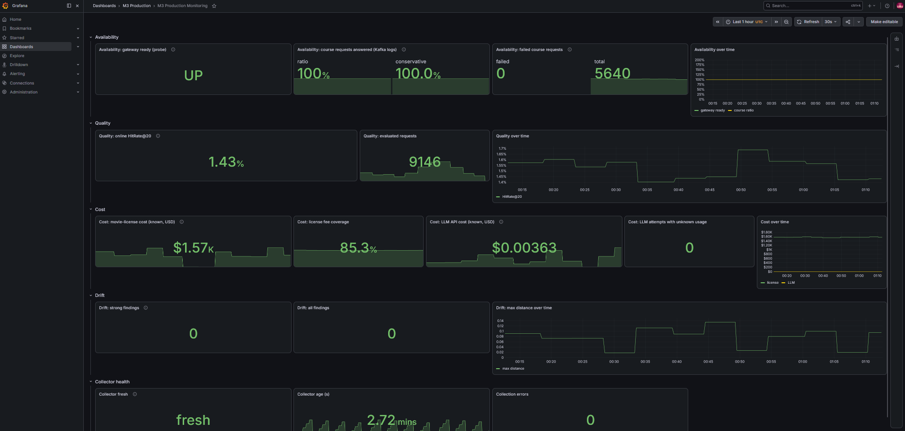
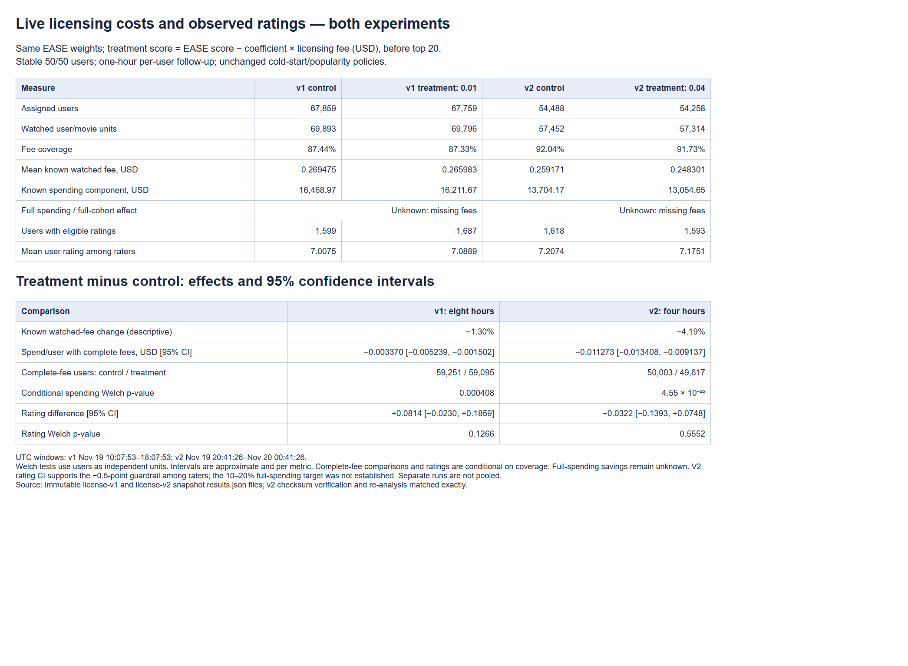
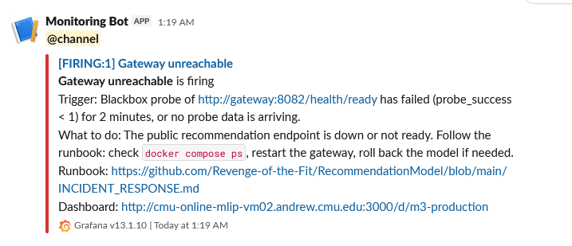

# Milestone 3: Operating our recommendation service

## Model version switching

In Milestone 1, one API container loaded the model and answered every request on port 8082. Replacing that container meant waiting for the new model to load before anybody could get a recommendation. We kept the same public address and put a gateway in front of two API containers, blue and green. Each loads its own model from a shared volume. This allows one to keep answering requests while we replace the other. [Deployment configuration](compose.yaml) · [Gateway](src/api/gateway.py)

Before switching traffic, we check that both slots are ready and send a recommendation request directly to the candidate. We verify that the request log contains the new model's hash, then replace the routing file in one operation. New requests pick up the change while requests already in progress can finish on their original slot. We repeat the check through the public gateway. If that check fails, the deployment script restores the previous routing file. [Switch and rollback](src/deployment.py) · [Request verification](src/model_update.py)

## Regular model updates

On November 20, 2026, we retrained EASE twice using events through 15:33 and 17:03 UTC, respectively. Both models returned 20 recommendations through the gateway. Across the two switch windows, the course logs recorded 10,209 requests for our server and zero failures. [Update script](scripts/update_model.sh)

| Switch (UTC) | New model | Five minutes before | Five minutes after |
| --- | --- | ---: | ---: |
| [15:51:25, blue to green](verification/m3-swap-evidence/20261120T153340Z-1027900/deployment.json) | `929f3381` | 2,298 / 2,298 | [2,336 / 2,336](verification/m3-swap-evidence/20261120T153340Z-1027900/availability.json) |
| [17:43:34, green to blue](verification/m3-swap-evidence/20261120T173503Z-1048657/deployment.json) | `6f87dded` | 2,763 / 2,763 | [2,812 / 2,812](verification/m3-swap-evidence/20261120T173503Z-1048657/availability.json) |

## Monitoring

We check availability two ways. Prometheus probes the gateway every 15 seconds. Our collector reads the course Kafka logs about every five minutes to measure the fraction of requests for our server that returned HTTP 200. Grafana shows that ratio as stale if the logs do not cover the window. For online accuracy, a successful top-20 recommendation list counts as a hit if the same user watches any movie on it within an hour. [Prometheus configuration](monitoring/prometheus/prometheus.yml) · [Collector and metrics](src/monitoring.py)

We estimate license cost by counting one fee per observed user/movie pair and show what fraction had a known fee. We estimate LLM cost from recorded token usage and API prices. For drift, we compare Kafka events and responses from the user, movie, and recommendation APIs with our M2 baseline. A total variation distance above 0.30 flags a strong shift. Our mentor can view Grafana over the CMU VPN. We will send the login details by email. [Drift checks](src/data_quality.py) · [Live dashboard](http://cmu-online-mlip-vm02.andrew.cmu.edu:3000/d/m3-production)

We configured one automated alert. If the gateway readiness probe fails for two minutes or probe data goes missing, Grafana sends an `@channel` message to `#alerts-and-monitoring` with the trigger and the recovery instructions. [Alert rule](monitoring/grafana/provisioning/alerting/rules.yml) · [Slack delivery](monitoring/grafana/provisioning/alerting/contact-points.yml)



## Experimentation infrastructure

We split users 50/50 between blue (control) and green (treatment). The gateway hashes the user ID with a salt saved for that experiment. This means that a user who comes back later gets the same assignment. Before enrollment, we record both serving versions, the split, the fee snapshot, and the end time. A user's first request starts one hour of follow-up. We log both the assigned and actual slot and keep the user in the assigned group even if a request fails or the other slot answers. [Assignment](src/routing.py) · [Experiment setup](src/license_experiment.py) · [Gateway log](src/api/gateway.py)

We save Kafka watches and ratings before the database combines repeated watch events. For spending, we count each movie a user watches during follow-up once, including movies outside our recommendations. A user who watches nothing contributes zero. For satisfaction, we take the latest eligible 1–10 rating for each watched movie and average those ratings within each user. This gives somebody who rates ten movies the same weight as somebody who rates one. [Outcome capture](src/experiments/capture.py) · [Scoring](src/experiments/analysis.py)

We compare the group means with two-sided Welch t-tests and report the treatment-minus-control difference, a 95% confidence interval, and a p-value. We use one observation per user because we assigned users to groups and their repeated watches are related. Welch's test allows the groups to have different variances. We fixed enrollment at seven hours for the first run and three for the second, then allowed another hour for the last users to finish follow-up. Its saved snapshot can be analyzed again with the same requests, outcomes, and fees. [Analysis and reproduction instructions](M3_EXPERIMENTS.md#export-reproduce-and-finish)

## Experiment results

We tested whether we could get users to watch cheaper movies without lowering their ratings. Both groups used the same EASE weights. For personalized recommendations, green subtracted the movie's license fee in dollars times 0.01 in the first run and 0.04 in the second before selecting the top 20. Both groups kept the same cold-start and popularity rules. [Ranking implementation](src/recommender.py)

The mean known fee per watched movie was 1.30% lower in the first treatment group and 4.19% lower in the second. In the second run, users whose watches all had known fees cost about 1.13 cents less per user (95% CI, 0.91 to 1.34 cents less). Fees were missing for about 8% of watched pairs in that run, so we could not establish our target of 10% lower total spending. Among users who rated movies, the treatment averaged 0.081 points higher in the first run. In the second, treatment averaged 7.18 compared with 7.21 for control. The estimated difference was −0.032 points (95% CI, −0.139 to +0.075). That interval includes zero, and even its lower end is above the half-point drop we set as our limit. [First run](verification/m3-license-v1-results.json) · [Second run](verification/m3-license-v2-results.json)



## Provenance

Every successful response includes an `x-request-id`. We use it to look up the recommendation list, how it was produced, the model's SHA-256 hash, and the serving version in SQLite. The serving version includes the ranking settings, which matters here because the two experimental models used the same weights. Its manifest points to the saved model, EASE parameters, training code revision, and exact training files. We keep a copy of the candidate and training snapshot for each update so a later switch does not overwrite them. [Request logging](src/api/request_logging.py) · [Manifest and lookup](src/provenance.py)

For example, request `fa6097a09a134893b7dcd5d72dc2cb8a` returned 20 movies through the gateway after the second switch. The request identified serving version `d996f251` and model `6f87dded`. We trained that model at commit `0c6d935` using EASE with regularization 100 and a minimum positive rating of 6. The exact inputs are `events.csv.gz`, `movies.csv.gz`, and `users.csv.gz` under `/app/models/updates/20261120T173503Z-1048657/data` on the VM. The archived manifest gives the full hash of each file. [Public request](verification/m3-swap-evidence/20261120T173503Z-1048657/deployment.json) · [Training manifest](verification/m3-swap-evidence/20261120T173503Z-1048657/artifact-manifest.json) · [Trainer at that commit](https://github.com/Revenge-of-the-Fit/RecommendationModel/blob/0c6d935f5ad9b8ad69d5882e655deb3d41044b2c/src/train.py)

From `/home/production` on the VM, run the following lookup with any retained recommendation's request ID. It checks the model and training files against their saved hashes. [Example of a verified lookup](verification/m3-provenance-2026-11-14.json)

```bash
sudo docker compose --project-name recommendationmodel exec -T api \
  python src/provenance.py fa6097a09a134893b7dcd5d72dc2cb8a
```

## Incident response plan and drill

Management can reach our team by email. The first teammate to see an urgent request alerts the rest of us in Slack. The first person to acknowledge the incident leads the response, the engineer responsible for the affected service handles recovery, and we keep updates in one Slack thread. [Team incident response plan](INCIDENT_RESPONSE.md)

On November 20 at about 01:17 UTC, we set a four-minute restart timer and stopped the gateway. Grafana showed the gateway down while the course-log panel still showed 100% for its earlier window. At 01:19 UTC the readiness alert fired, and William Blackwood saw the message in Slack. By 01:22 UTC, `/recommend/1` was returning HTTP 200 again and Slack had delivered the resolved alert. [Gateway stop](verification/m3_drill/Drill_2.png) · [Detection](verification/m3_drill/Drill_4.png) · [Recovered request](verification/m3_drill/Drill_8.png) · [Resolved alert](verification/m3_drill/Drill_9.png)



## Team contract update

no update to team contract
